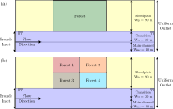
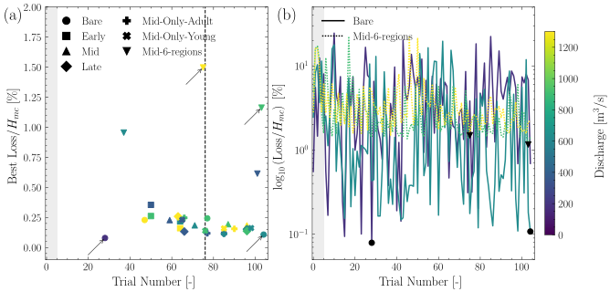
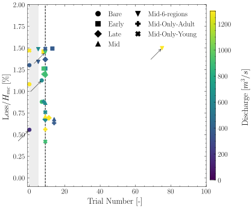
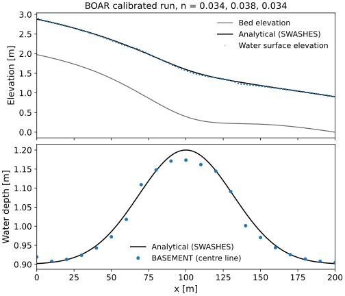
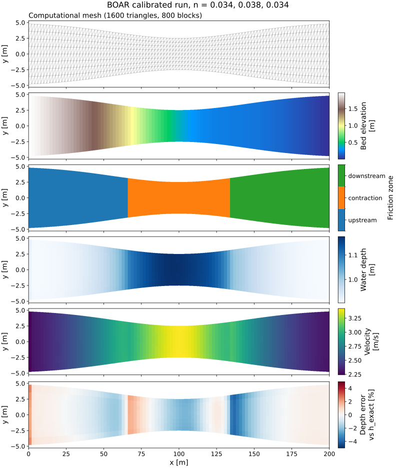
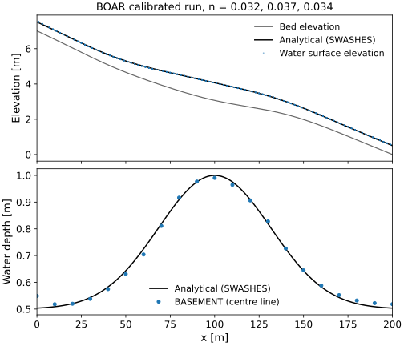
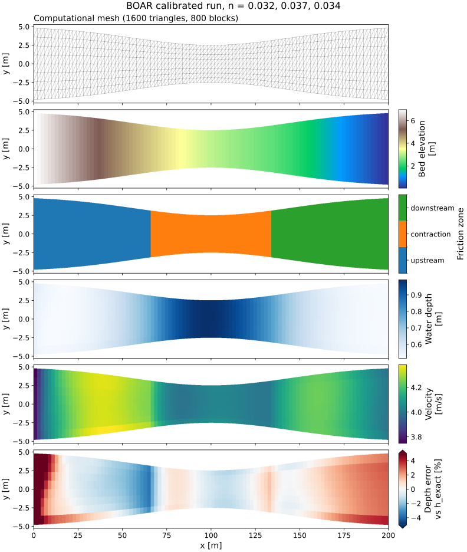
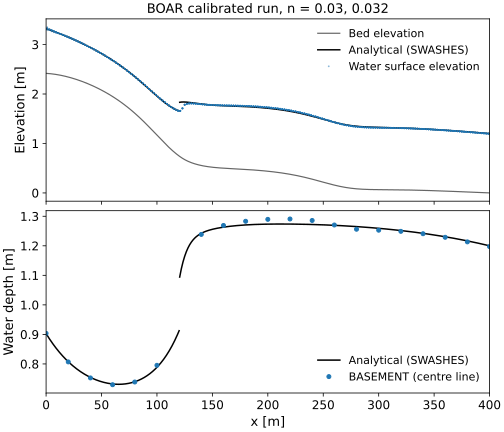
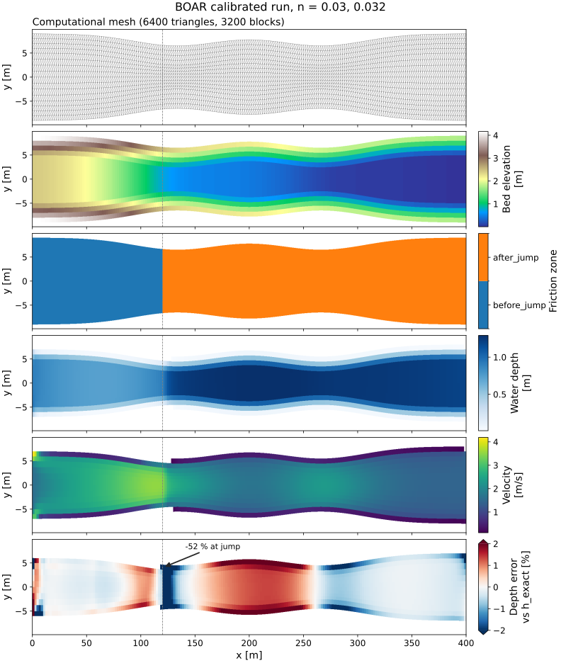

Shallow-Water Benchmarks
========================

This page documents the calibration of two-dimensional shallow-water models with BASEMENT: a compound channel, and light cases with analytical solutions (SWASHES MacDonald channels: subcritical, supercritical and hydraulic jump), which can be run locally to test an installation of BASEMENT and BOAR. The benchmarks of the optimization engine are documented in :doc:`Optimization Engine Benchmarks </benchmarks>`.

.. contents::
   :local:

Compound Channel Benchmark (BASEMENT v4.2)
------------------------------------------

A compound channel benchmark is included to demonstrate the framework's ability to handle a two-dimensional hydrodynamic models calibration. The compound channel was divided into three friction zones (main channel, floodplain, and floodplain forest), each with a different Strickler's roughness coefficient (Figure 1). The search space for the optimization had 1 dimension (overbank flow), 2 dimensions (main channel and floodplain), 3 dimensions (main channel, floodplain, and floodplain forest), and additional 6-dimensional case was considered, at which the floodplain forest was divided into 4 zones.
The goal of the optimization is to calibrate these coefficients to match observed water levels and flow rates.

   **Figure 1:** Numerical simulations domain and boundary conditions. (a) For all Bare and Forest scenarions, and (b) artificial dim = 6 scenario  applied to the Mid vegetation. Each colour represents a hydraulic roughness region

The loss is computed in terms of the Root Mean Square Error (RMSE) between the observed and simulated water levels and flow rates, normalized by the main channel flow depth. The following conditions were used for the optimization:

.. code-block:: yaml

    optimization_variable_options:
      'bounds': [!!python/tuple [20, 60], !!python/tuple [20, 60], !!python/tuple [10, 35]] # Main channel, Floodplain, Floodplain Forest
      'constraints':
        'expression': "z < x and z < y"  # Floodplain Forest < Main channel and Floodplain
        'variables': ['x', 'y', 'z']
      'precision': 0.1
      'n_initial': 5

    surrogate_model_options:
      'max_tested_vectors': 100
      'max_no_improvement': 100
      'tolerance': 1e-4
      'GPR_iterations': 500
      'test_population': 80200

    sampling_options:
      'seed': 9

The following results were obtained for the BASEMENT benchmark using the BOAR engine:

   **Figure 2:** Calibration-convergence analysis based on the normalized :math:`\mathrm{RMSE}/H_{mc}`: (a) best loss value (%) versus trial number; (b) loss-value trajectories for the *Bare* and *Early* cases at the trials highlighted by arrows in panel (a). The dashed line in panel (a) denotes the median number of trials required to obtain the optimal loss, and the black markers in panel (b) indicate the corresponding optimal solution. The shaded light gray area represents the initial training phase. All simulations were performed on a Froude-scaled model at a 1:1 prototype scale.

Note that the convergence is highly tied to the desired tolerance. For instance, if the tolerance is increased to 1.5%, the convergence is achieved in fewer trials (median = 9 trials), as shown in Figure 3.

   **Figure 3:** Calibration-convergence analysis based on the normalized :math:`\mathrm{RMSE}/H_{mc}` (Loss) versus trial number, with an error threshold of :math:`\mathrm{Loss}/H_{mc} \leq 1.5\%`. The shaded light gray area represents the initial training phase. All simulations were performed on a Froude-scaled model at a 1:1 prototype scale.

For a more in depth information about the compound channel benchmark, please check de Oliveira et al. (2026) [1]_.

SWASHES MacDonald Channels (BASEMENT 4.3)
-----------------------------------------

Light BASEMENT benchmarks with analytical reference solutions are shipped with BOAR, to check a local
installation of BASEMENT and BOAR end to end. They generate the mesh, the BASEMENT configuration and the ground
truth, run BASEMENT, calibrate the Manning coefficients of a few friction regions with BOAR and compare the final
water depth with the analytical one. Three steady cases of the MacDonald pseudo-2D solutions in SWASHES [2]_
cover the three flow regimes:

.. list-table::
   :header-rows: 1

   * - ``--case``
     - SWASHES
     - Flow
     - Channel
     - Boundary conditions
   * - | ``subcritical``
       | (default)
     - § 3.5.1
     - subcritical
     - | 200 m
       | rectangular
     - | :math:`Q` upstream
       | :math:`h_{out}` downstream
   * - ``supercritical``
     - § 3.5.2
     - supercritical
     - | 200 m
       | rectangular
     - | :math:`Q`, :math:`h_{in}` upstream
       | free outflow
   * - ``jump``
     - § 3.5.6
     - | smooth transition,
       | then hydraulic jump
     - | 400 m, trapezoidal
       | side slope :math:`Z = 2`
     - | :math:`Q` upstream
       | :math:`h_{out}` downstream

Each case runs with or without BASEMENT's k-epsilon turbulence model (default constants, started once the
channel has filled: t = 300 s, or 100 s in the short supercritical run). By default the jump case uses k-epsilon,
which takes over part of the resistance after the jump and improves the result, and the short channels run without
a turbulence model; ``--turbulence none`` or ``--turbulence k_epsilon`` overrides the default. They need BASEMENT
4.3 and take a few minutes on a laptop:

.. code-block:: bash

    uv run python benchmarks/basement_macdonald.py                          # subcritical case
    uv run python benchmarks/basement_macdonald.py --case supercritical     # or --case jump
    uv run python benchmarks/basement_macdonald.py --analytical-manning     # analytical_manning run only
    uv run python benchmarks/basement_macdonald.py --turbulence k_epsilon   # override the turbulence model
    uv run pytest -m "slow and requires_basement" tests/test_basement_macdonald.py

Each variant writes to its own folder, ``output/benchmarks/swashes_macdonald[_<case>]/`` for the case default and
with a ``_k_epsilon`` or ``_no_turbulence`` suffix otherwise (inputs, run folder, log and figures). The benchmark sets its own options and loss function and leaves
``user_defined_configs/`` untouched. Without BASEMENT it prints a message and exits.

Analytical solutions
~~~~~~~~~~~~~~~~~~~~

All cases carry :math:`Q = 20` m³/s with a Manning coefficient :math:`n = 0.03` s/m\ :sup:`1/3` in a channel of
bottom width :math:`B(x)` and side slope :math:`Z` (isosceles trapezoid; :math:`Z = 0` is a rectangle). The bed
:math:`z(x) = \int_x^L S_0(X)\,dX` follows from the closed-form bed slope of section 3.5:

.. math::

    S_0 = {} & \left(1 - \frac{Q^2 (B + 2Zh)}{g h^3 (B + Zh)^3}\right) h' \\
          & + \frac{Q^2 n^2 \left(B + 2h\sqrt{1 + Z^2}\right)^{4/3}}{h^{10/3} (B + Zh)^{10/3}} \\
          & - \frac{Q^2 B'}{g h^2 (B + Zh)^3}.

The short channels (§ 3.5.1 and § 3.5.2, :math:`L = 200` m, :math:`Z = 0`) have the width

.. math::

    B_1(x) = 10 - 5 \exp\left(-10 \left(\frac{x}{200} - \frac{1}{2}\right)^2\right)

and the depths

.. math::

    h_{3.5.1}(x) = 0.9 + 0.3 \exp\left(-20 \left(\frac{x}{200} - \frac{1}{2}\right)^2\right),

.. math::

    h_{3.5.2}(x) = 0.5 + 0.5 \exp\left(-20 \left(\frac{x}{200} - \frac{1}{2}\right)^2\right).

The long channel (§ 3.5.6, :math:`L = 400` m, :math:`Z = 2`) has the bottom width

.. math::

    B_2(x) = {} & 10 - 5 \exp\left(-50 \left(\frac{x}{400} - \frac{1}{3}\right)^2\right) \\
               & - 5 \exp\left(-50 \left(\frac{x}{400} - \frac{2}{3}\right)^2\right)

and the depth

.. math::

    h(x) = {} & 0.9 + 0.25 \left(e^{-x/40} - 1\right) + 0.25 \exp\left(15 \left(\frac{x}{400} - \frac{3}{10}\right)\right)
         \\ & \text{for } x \le 120 \text{ m},

.. math::

    h(x) = {} & e^{-p (x - x^*)} \sum_{i=0}^{2} k_i \left(\frac{x - x^*}{x^{**} - x^*}\right)^i + \varphi(x)
         \\ & \text{for } x > 120 \text{ m},

with :math:`x^* = 120` m, :math:`x^{**} = 400` m, :math:`p = 0.09`, :math:`k = (-0.183691, 1.519577, -18.234429)`
and :math:`\varphi(x) = 1.5 \exp(0.16 (x/400 - 1)) - 0.3 \exp(2 (x/400 - 1))`. The jump at :math:`x = 120` m
(from 0.912 m, Froude number 1.16, to 1.083 m) conserves the momentum of the trapezoid.

Notes on the paper: for § 3.5.1, Table 2 gives :math:`h_{out} = 0.902921` m while :math:`h(200) = 0.902021` m;
the benchmark imposes :math:`h(L)`. For § 3.5.6, the paper prints the range of the second branch as
:math:`120 \le x \le 200` m; with :math:`x^{**} = 400` m and :math:`h(400) = 1.2` m :math:`= h_{out}` it is
120–400 m. The numpy implementation of § 3.5.1 is cross-checked against SWASHES through pyswashes [3]_ in
``tests/test_basement_macdonald.py``. SWASHES outputs, per cell, the depth, the ground elevation and the head
(water surface); it writes the ground elevation with a first-order sum of :math:`S_0` on its output grid,
which the test reproduces, while the benchmark integrates :math:`S_0` accurately on a fine grid. pyswashes is a dev dependency only (``uv sync`` installs it), but it does
not ship the ``swashes`` program; install it with ``conda install -c lrntct pyswashes``, which brings the
``swashes`` package (or build SWASHES from source) to run that check, which is skipped otherwise.

BASEMENT model
~~~~~~~~~~~~~~

.. list-table::
   :header-rows: 1
   :widths: 22 78

   * - Item
     - Setting
   * - Domain
     - | the analytical reach, x from 0 to L
       | boundary conditions imposed at its ends, as in SWASHES
   * - Mesh
     - | structured, generated in Python; 2 m cross sections
       | 8 cells across the bottom, 4 on each bank of the trapezoid
       | every rectangle split into two right triangles with the same diagonal
       | 1600 triangles (short channels), 6400 (long channel)
   * - Side walls
     - | rectangular channels: none in the mesh, which ends at :math:`y = \pm B(x)/2`
       | (default BASEMENT walls: no flux, free slip, no friction)
       | trapezoid: banks in the bathymetry, rising 2 m above the bed to a dry crest
   * - Friction
     - | Manning, one coefficient per region along the channel
       | short channels: ``upstream``, ``contraction``, ``downstream`` (thirds: 0–66.7–133.3–200 m)
       | § 3.5.6: ``before_jump`` (0–120 m), ``after_jump`` (120–400 m)
       | each mesh rectangle belongs to the region of its centre
   * - Boundary conditions
     - | § 3.5.1: ``uniform_in`` (0 → 20 m³/s in 10 s), ``zhydrograph`` at :math:`z(L) + h_{out}`
       | § 3.5.2: ``zqhydrograph`` at :math:`z(0) + h_{in}` with :math:`Q / B(0)` (same ramp),
       | ``zero_gradient_out``
       | § 3.5.6: ``froude_in`` (Froude number giving :math:`h(0)`), ``zhydrograph`` at
       | :math:`z(L) + h_{out}`
   * - Initial condition
     - dry
   * - Numerics
     - | CFL 0.5, minimum water depth 1 mm, safe mode on
       | turbulence: k-epsilon in § 3.5.6, none in § 3.5.1 and § 3.5.2 (defaults)
       | simulated time (steady state): 900 s (§ 3.5.1), 300 s (§ 3.5.2), 1200 s (§ 3.5.6)
       | one output at the end
   * - Calibration
     - | Manning n of every region in [0.015, 0.060], precision 0.001
       | 5 initial samples and at most 15 BASEMENT runs per region
       | stop after 5 runs without improvement

In § 3.5.6 the inflow uses ``froude_in`` rather than ``uniform_in``: after the dry start the water runs down the
steep upstream reach as a supercritical flow, and ``uniform_in`` keeps that shallow inflow (a second steady state
with a jump near the inlet) instead of the analytical subcritical one.

The comparison uses block values: the area-weighted mean of the two triangles of every mesh rectangle. The
depth at the centre-line points (21 per case, every 10 m in the short channels and 20 m in the long one; the
point on the jump is left out) is the inverse-distance weighted mean of the 6 nearest blocks, as BOAR's default
loss does with cells. The loss of the calibration is the RMSE of these depths against :math:`h(x)`.

Pass criterion and effective Manning coefficient
~~~~~~~~~~~~~~~~~~~~~~~~~~~~~~~~~~~~~~~~~~~~~~~~

Each case makes two BASEMENT runs:

* **analytical_manning**: BASEMENT with the analytical coefficient :math:`n = 0.03`. It checks the set-up and
  is reported for information only.
* **BOAR calibrated**: BOAR calibrates the Manning coefficients of the friction regions against the analytical
  depths, then BASEMENT runs once more with the best coefficients.

A case passes when the RMSE of the final water depth of the BOAR calibrated run is at most 0.05 m. The calibrated
Manning coefficients are **not** expected to equal the analytical :math:`n = 0.03`. They are *effective* values
that also absorb numerical effects (discretisation, mesh resolution, numerical diffusion) and model differences. The
main difference in the rectangular channels is the side-wall friction: the pseudo-2D solutions include it
through the hydraulic radius :math:`A/P` (the term :math:`(B + 2h)^{4/3}`), which raises the friction slope by up
to 70 % at the contraction, while BASEMENT 2D applies bed friction only (its walls are free slip). With
:math:`n = 0.03` BASEMENT therefore gives a lower water depth. The wall share of the friction varies along the
channel, largest at the contraction, so a single coefficient for the whole channel leaves a residual error;
the friction regions let the calibration follow it (the contraction gets the largest coefficient). In the
trapezoidal channel the banks are part of the bathymetry and BASEMENT applies friction on them.

Results on a laptop: AMD Ryzen 7 PRO 7840U (8 cores, 16 threads), Windows 11, BASEMENT 4.3, OpenMP backend with
16 threads (``nthreads: -1``), default turbulence model of each case (k-epsilon only in § 3.5.6).

Subcritical flow (§ 3.5.1)
~~~~~~~~~~~~~~~~~~~~~~~~~~

.. list-table::
   :header-rows: 1

   * - Run
     - Manning n (per region)
     - Depth RMSE [m]
     - Max. abs. depth error [m]
     - Runtime
   * - analytical_manning
     - 0.030
     - 0.107
     - 0.177
     - 6 s
   * - BOAR calibrated (24 BASEMENT runs)
     - 0.034, 0.038, 0.034
     - 0.014
     - 0.033
     - 122 s

   **Figure 4:** Water surface, bed and centre-line water depth of the BOAR calibrated run against the SWASHES
   solution, § 3.5.1.

   **Figure 5:** Mesh, bed elevation, friction zones, water depth, velocity magnitude and relative water-depth
   error (block values) of the BOAR calibrated run, § 3.5.1. The depth error is
   :math:`100\,(h - h_{exact}) / h_{exact}` with the local analytical depth
   :math:`h_{exact} = z(x) + h(x) - z_{block}` (the analytical water surface minus the block bed; :math:`h(x)` on
   the flat bottom). The pseudo-2D solution gives only the cross-section mean velocity, so no velocity error is
   shown. The axes are stretched across the channel.

Supercritical flow (§ 3.5.2)
~~~~~~~~~~~~~~~~~~~~~~~~~~~~

.. list-table::
   :header-rows: 1

   * - Run
     - Manning n (per region)
     - Depth RMSE [m]
     - Max. abs. depth error [m]
     - Runtime
   * - analytical_manning
     - 0.030
     - 0.066
     - 0.124
     - 5 s
   * - BOAR calibrated (21 BASEMENT runs)
     - 0.032, 0.037, 0.034
     - 0.014
     - 0.046
     - 28 s

   **Figure 6:** Water surface, bed and centre-line water depth of the BOAR calibrated run against the SWASHES
   solution, § 3.5.2.

   **Figure 7:** As Figure 5, for § 3.5.2. The colour scale ends at the 90th percentile of the absolute error, so
   the few large errors next to the inlet, where the water level is imposed, saturate (arrows on the colour bar).

Smooth transition and hydraulic jump (§ 3.5.6)
~~~~~~~~~~~~~~~~~~~~~~~~~~~~~~~~~~~~~~~~~~~~~~~

This case runs with the k-epsilon model by default. Without it (``--turbulence none``) the BOAR calibrated run
reaches a depth RMSE of 0.009 m with :math:`n` = 0.030 and 0.034 (24 BASEMENT runs, about half the run time).

.. list-table::
   :header-rows: 1

   * - Run
     - Manning n (per region)
     - Depth RMSE [m]
     - Max. abs. depth error [m]
     - Runtime
   * - analytical_manning
     - 0.030
     - 0.026
     - 0.065
     - 31 s
   * - BOAR calibrated (19 BASEMENT runs)
     - 0.030, 0.032
     - 0.008
     - 0.017
     - 640 s

   **Figure 8:** Water surface, bed and centre-line water depth of the BOAR calibrated run against the SWASHES
   solution, § 3.5.6.

   **Figure 9:** As Figure 5, for § 3.5.6. The depth error is shown where the analytical local depth exceeds
   15 cm (not at the waterline on the banks). Its colour scale ends at the 90th percentile of the absolute error,
   so the few large errors where BASEMENT smears the jump saturate (arrows on the colour bar) and the errors along
   the rest of the channel stay visible; the note gives the largest error at the jump.

References
----------

.. [1] LED. de Oliveira, MJ. Franca, NP. Huber, D. Vanzo, (2026). *BOAR: Bayesian optimization for automated roughness calibration in two-dimensional hydrodynamic models*. SoftwareX, 35, 102899. https://doi.org/10.1016/j.softx.2026.102899
.. [2] O\. Delestre, C. Lucas, P.-A. Ksinant, F. Darboux, C. Laguerre, T.N.T. Vo, F. James, S. Cordier (2013). *SWASHES: a compilation of Shallow Water Analytic Solutions for Hydraulic and Environmental Studies*. International Journal for Numerical Methods in Fluids, 72(3), 269-300. https://doi.org/10.1002/fld.3741. HAL: http://hal.archives-ouvertes.fr/hal-00628246
.. [3] *pyswashes*, a Python wrapper of the SWASHES program. https://github.com/lrntct/pyswashes (GPL-3.0)
